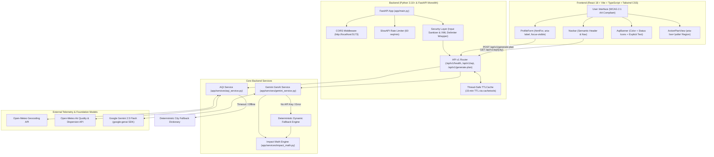

# VayuMitra (वायुमित्र) — Clean Air & Winter Smog Action Engine

[](https://opensource.org/licenses/MIT)
[](https://fastapi.tiangolo.com)
[](https://react.dev)
[-3178C6.svg?logo=typescript&logoColor=white)](https://www.typescriptlang.org)
[](https://tailwindcss.com)
[](https://ai.google.dev)
[](https://open-meteo.com)
[](https://www.w3.org/WAI/standards-guidelines/wcag/)

**VayuMitra** ("Friend of the Air") is a full-stack web application designed to help families and residential communities navigate hazardous winter smog crises (such as those across Delhi NCR, the Indo-Gangetic Plains, and global urban smog basins).

The application pairs live Open-Meteo atmospheric telemetry with structured **Gemini 2.5 Flash** GenAI action plans and deterministic environmental mathematics to deliver:
1. **Time-Blocked Daily Routines:** Exact diurnal ventilation windows (when to seal doors vs. when to flush indoor air) based on boundary-layer thermal inversions.
2. **Budget Indoor Air Hacks:** Low-cost DIY clean-air adaptations, including a complete blueprint for the **DIY Corsi-Rosenthal Box Air Filter** (~₹1,200 / $15), saline wet-mopping protocols, and kitchen pre-exhaust habits.
3. **Quantified Impact Explainer:** Exact mathematical breakdowns of personal PM2.5 inhalation reduction (%) and Berkeley Earth cigarette inhalation equivalents avoided.
4. **Community / RWA Advisory Generator:** A one-click WhatsApp and notice board circular formatter for apartment management committees and resident welfare associations.

---

## 🏗️ System Architecture



---

## 🧮 Mathematical Formulations in `impact_math.py`

### 1. Time-Weighted Microenvironmental Inhalation Exposure Model
Personal 24-hour PM2.5 inhalation concentration ($E$) is modeled across three primary daily microenvironments: Home ($15\text{h}$), Workplace/School ($7\text{h}$), and Daily Commute ($2\text{h}$):

$$E = \frac{(C_{\text{home}} \times 15) + (C_{\text{work}} \times 7) + (C_{\text{commute}} \times 2)}{24}$$

#### A. Baseline Exposure Components:
* **Indoor Home Exposure ($C_{\text{home, base}}$):**
  $$C_{\text{home, base}} = (C_{\text{ambient}} \times I_{\text{home}}) + C_{\text{cooking}}$$
  * Infiltration factor ($I_{\text{home}}$): $0.70$ for high-rise apartments; $0.82$ for ground-level independent houses.
  * Internal cooking emissions ($C_{\text{cooking}}$): $+20.0\ \mu\text{g/m}^3$ for standard LPG gas; $+85.0\ \mu\text{g/m}^3$ for solid biomass/wood; $+5.0\ \mu\text{g/m}^3$ for electric induction.
* **Workplace Exposure ($C_{\text{work, base}}$):** Typical building HVAC particulate reduction factor:
  $$C_{\text{work, base}} = C_{\text{ambient}} \times 0.65$$
* **Commute Exposure ($C_{\text{commute, base}}$):** Roadside vehicular tailpipe plume multiplier ($F_{\text{commute}}$):
  $$C_{\text{commute, base}} = C_{\text{ambient}} \times F_{\text{commute}}$$
  * Two-Wheeler (Motorbike/Scooter): $F = 1.85$ (direct plume respiration).
  * Walk / Bicycle: $F = 1.70$ (elevated physical ventilation rate).
  * Public Transit (Bus/Metro): $F = 0.95$.
  * Car (Petrol/Diesel cabin with AC recirculation): $F = 0.50$.
  * Work From Home (WFH): $F = 0.0$.

#### B. Mitigated Exposure Components (VayuMitra Protocol):
* **Mitigated Home ($C_{\text{home, mit}}$):** DIY Corsi-Rosenthal / HEPA filtration plus foam door weatherstripping and kitchen pre-exhaust:
  $$C_{\text{home, mit}} = (C_{\text{ambient}} \times I_{\text{home}} \times 0.22) + (C_{\text{cooking}} \times 0.25)$$
* **Mitigated Commute ($C_{\text{commute, mit}}$):** Certified, tightly sealed N95 respirator mask usage:
  $$C_{\text{commute, mit}} = C_{\text{commute, base}} \times 0.08 \quad (\text{92\% inhalation reduction})$$
* **Mitigated Work ($C_{\text{work, mit}}$):** $C_{\text{work, base}} \times 0.70$.

#### C. Exposure Reduction Percentage:
$$\text{PM2.5 Exposure Reduction (\%)} = \left(\frac{E_{\text{baseline}} - E_{\text{mitigated}}}{E_{\text{baseline}}}\right) \times 100$$

---

### 2. Berkeley Earth Cigarette Inhalation Equivalence
According to Berkeley Earth environmental epidemiology, inhaling an average of $22\ \mu\text{g/m}^3$ of PM2.5 continuously over 24 hours results in particulate lung deposition approximately equal to smoking one cigarette:

$$\text{Cigarettes Avoided / Day} = \frac{E_{\text{baseline}} - E_{\text{mitigated}}}{22.0\ \mu\text{g/m}^3}$$

---

### 3. Commute Carbon Dioxide ($\text{CO}_2$) Emission Savings
Daily transport emissions saved by switching to public transit or electric commuting for a standard urban round trip ($d = 25\text{ km}$):

$$\Delta \text{CO}_2\ (\text{kg/day}) = d \times (EF_{\text{baseline}} - EF_{\text{transit}})$$

* Passenger Car (Petrol/Diesel): $EF = 0.175\text{ kg CO}_2/\text{km}$
* Two-Wheeler (100–150cc scooter): $EF = 0.048\text{ kg CO}_2/\text{km}$
* Electric Public Transit (Metro / Electric Bus): $EF = 0.038\text{ kg CO}_2/\text{passenger-km}$
* Shifting from a car to metro saves $\approx 3.42\text{ kg CO}_2/\text{day}$ ($\approx 102.6\text{ kg CO}_2/\text{month}$).

---

## 🔒 Security & Accessibility Measures

### Security Implementations:
1. **Adversarial Prompt Injection Guard:** Regex pattern scanner detecting system overrides, jailbreak phrases (e.g., `DAN`, `ignore previous instructions`), and XML breakout attempts, rejecting attacks with HTTP 400 Bad Request.
2. **Strict XML Delimiter Isolation (`<user_input>` & `<user_context>`):** Untrusted user strings are sanitized and wrapped within explicit XML boundary tags before LLM prompt interpolation:
   ```python
   def wrap_user_input(text: str) -> str:
       return f"<user_input>\n{sanitize_input(text)}\n</user_input>"
   ```
3. **Strict Pydantic v2 Input Validation:** String lengths are capped with `Field(max_length=...)` and validated against unauthorized characters; oversized payloads are rejected with HTTP 422 Unprocessable Entity.
4. **Mandatory HTTP Security Headers:** Custom FastAPI middleware automatically injects:
   - `X-Content-Type-Options: nosniff` (blocks MIME-type sniffing attacks)
   - `X-Frame-Options: DENY` (prevents clickjacking)
   - `X-XSS-Protection: 1; mode=block`
5. **SlowAPI Sliding-Window Rate Limiting:** Enforces `60 requests/minute` per remote client IP address to prevent API flooding and denial-of-service.
6. **Thread-Safe In-Memory Caching (`cachetools.TTLCache`):** 15-minute TTL caches for city AQI telemetry and identical action plan requests with thread locking.
7. **Non-Blocking Shared HTTP Client Lifecycle:** Employs a shared singleton `httpx.AsyncClient` with explicit connect/read timeouts and graceful lifespan shutdown, avoiding connection socket exhaustion.
8. **Graceful Degradation:** If `GEMINI_API_KEY` is omitted or API quotas are exceeded, the app falls back to the deterministic expert engine—guaranteeing zero 500 crashes.

### Accessibility Implementations (WCAG 2.1 AA Compliant):
1. **Skip-to-Content Navigation:** A hidden keyboard shortcut (`<a href="#main-content">`) appears on tab focus, allowing keyboard-only users to bypass repetitive navigation landmarks.
2. **Heading Hierarchy:** Strict `<h1>` (application branding) to `<h2>` (sections) to `<h3>` (cards) hierarchy without skipped levels for screen reader navigability.
3. **Semantic Landmarks:** Implemented with semantic landmarks: `<header>`, `<nav aria-label="Main Navigation">`, `<main id="main-content">`, `<section>`, `<fieldset>`, and `<legend>`.
4. **Form Accessibility:** Every form control is bound to a visible `<label>` using explicit `htmlFor` and `id`, with `aria-label` and `aria-required="true"`.
5. **Focus State Management:** Clear, high-contrast accessible focus indicators on all interactive inputs, selects, and buttons (`focus-visible:ring-2 focus-visible:ring-teal-600 focus-visible:outline-none`).
6. **Color Independence (WCAG 1.4.1):** The `AqiBanner` pairs background severity colors with **explicit text labels** (`"Severe / Hazardous - 335 AQI"`) and **status icons** (`🛑`, `🚨`, `⛔`, `⚠️`, `✅`) so color is never the sole indicator of health severity.
7. **Dynamic Screen Reader Updates:** The action plan results container is wrapped in `aria-live="polite"` (`role="region"`) and updates `aria-busy` during loading, allowing screen readers to announce generated plans without interrupting user navigation.
8. **Clipboard Feedback:** The RWA WhatsApp notice copy button provides visual confirmation (`"Copied to Clipboard!"`) and updates button text.

---

## 🚀 Local Setup & Execution Guide

### Prerequisites
* **Python 3.10+**
* **Node.js 18+** & **npm**

---

### Step 1: Environment Variables
Create a `.env` file in the project root (or copy `.env.example`):
```bash
cp .env.example .env
```
*(Optional: Add your `GEMINI_API_KEY`. If left blank, VayuMitra automatically runs its deterministic expert engine with 100% functionality).*

---

### Step 2: Backend Setup & Execution
```bash
# 1. Navigate to backend directory
cd backend

# 2. Create and activate virtual environment
python3 -m venv .venv
source .venv/bin/activate  # On Windows: .venv\Scripts\activate

# 3. Install required dependencies
pip install -r requirements.txt

# 4. Start the FastAPI development server
PYTHONPATH=. uvicorn app.main:app --host 127.0.0.1 --port 8000 --reload
```
* Backend API live at: **[http://127.0.0.1:8000](http://127.0.0.1:8000)**
* Interactive Swagger API Docs: **[http://127.0.0.1:8000/docs](http://127.0.0.1:8000/docs)**
* Health Check: **[http://127.0.0.1:8000/api/v1/health](http://127.0.0.1:8000/api/v1/health)**

---

### Step 3: Frontend Setup & Execution
```bash
# In a new terminal, navigate to frontend directory
cd frontend

# 1. Install dependencies
npm install

# 2. Start the Vite development server
npm run dev
```
* Frontend Application live at: **[http://localhost:5173](http://localhost:5173)**

---

## 🧪 Automated Testing & Code Quality Verification

### Run Backend Linting (Ruff)
```bash
backend/.venv/bin/ruff check backend/
```
* **Status:** 0 errors, 0 warnings across all backend modules.

### Run Backend Tests (Pytest — 12 Comprehensive Tests)
```bash
cd backend
PYTHONPATH=. .venv/bin/pytest tests/ -v
```
* **Coverage:** Validates system health check, impact math formulas, security sanitization and XML wrapping, Open-Meteo AQI endpoints, prompt injection rejection (400 Bad Request), dynamic plan fallback, mocked Gemini SDK structured output, AQI network error fallback, TTLCache hit/miss mechanics, oversized input rejection (422 Unprocessable Entity), mandatory security headers, and root metadata.

### Run Frontend Typecheck & Linting
```bash
cd frontend
npm run lint       # Runs tsc --noEmit (strict type check)
```
* **Status:** 0 TypeScript errors under `strict: true`.

### Run Frontend Tests (Vitest — 5 Component & A11y Tests)
```bash
cd frontend
npx vitest run
```
* **Coverage:** Validates semantic header/navigation rendering with landmarks, accessible ProfileForm label associations, AQI banner explicit text & icon pairing, mocked API form submission, `aria-live="polite"` results rendering, and clipboard copy feedback.

### Verify Production Frontend Build
```bash
cd frontend
npm run build
```
* Compiles Vite TypeScript bundle under strict type checking (`"strict": true`) with zero errors.

---

## 📜 License
MIT License. Built for public health impact and community clean air resilience.
